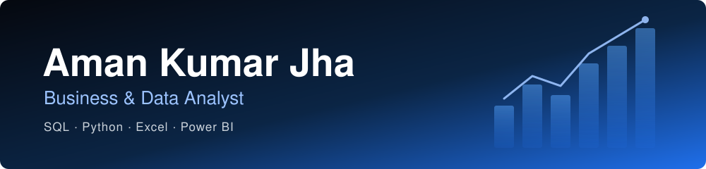

 

## Hello, I'm Aman

I am a **Business & Data Analyst** with **3.5 years of professional experience** across sales, customer support, operations, reporting, and analytics-related work. I work with data to understand business performance, find the reasons behind trends, and support better decisions.

I enjoy solving problems such as:

- Why are customers leaving, and how can retention improve?
- Which KPIs show the real health of a business?
- Where do processes slow down, and how can they be made simpler?
- How can raw numbers become a clear dashboard that stakeholders can use?

---

## About Me

My career started in business-facing roles. Working close to sales, support, and operations taught me how data is created, where it breaks, and what teams really need from reports.

Today, I focus on turning raw data into meaningful business insights. My main areas of interest are:

- **Business performance:** tracking KPIs and explaining what drives them
- **Reporting and dashboards:** building clear, decision-ready views of data
- **Retention and churn:** understanding why customers stay or leave
- **Process improvement:** using root cause analysis to remove bottlenecks

My goal is to grow my career in **Business Analytics, Data Analytics, and Business Intelligence**.

---

## Experience

**Product Operational Specialist | LimeChat** (current)
Chatbot QA, analysis, and internal tooling at an AI company.

**Revenue & Sales Analyst | PagarBook**
- Closed ₹25+ Lakhs in net revenue and achieved 110%+ of sales targets
- Built dashboards to track revenue, conversion, onboarding, and product adoption

**Team Lead | NoBroker**
- Led a team of 6+ people
- Built reporting systems that improved SLA tracking accuracy by 32%
- Improved SOPs and reduced turnaround time by 17%
- Automated follow-ups, saving about 20 hours a month

**Education:** Aryabhatta Knowledge University, Patna

**Open to:** Business Analyst, Data Analyst, Revenue Operations, Sales Operations, and Customer Success Operations roles in Bengaluru (on-site or hybrid).

---

## Technical Skills

**Programming**

**Data Analysis**

-0B2545?style=for-the-badge&logo=pandas&logoColor=58A6FF)

**Visualization**

**Business Analytics**

**CRM Tools**

**Other Skills**

---

## Projects

My analytics projects will be published here as I complete them. Each project will include the business question, the data used, the method, the key insights, and the tools.

| Area | Focus | Status |
| :--- | :--- | :--- |
| SQL Analytics | Querying and analysing business data | Coming soon |
| Python Data Analysis | Data cleaning and analysis with Pandas | Coming soon |
| Excel Business Reporting | KPI reports and business summaries | Coming soon |
| Power BI Dashboards | Interactive dashboards for business metrics | Coming soon |
| Business Analytics Projects | Retention, churn, and performance analysis | Coming soon |

---

## Currently Working On

- Improving my **SQL** and **Python** skills
- Building analytical projects for my portfolio
- Developing interactive **Power BI** dashboards
- Learning advanced business analytics techniques

---

## GitHub Stats

---

## Connect With Me

